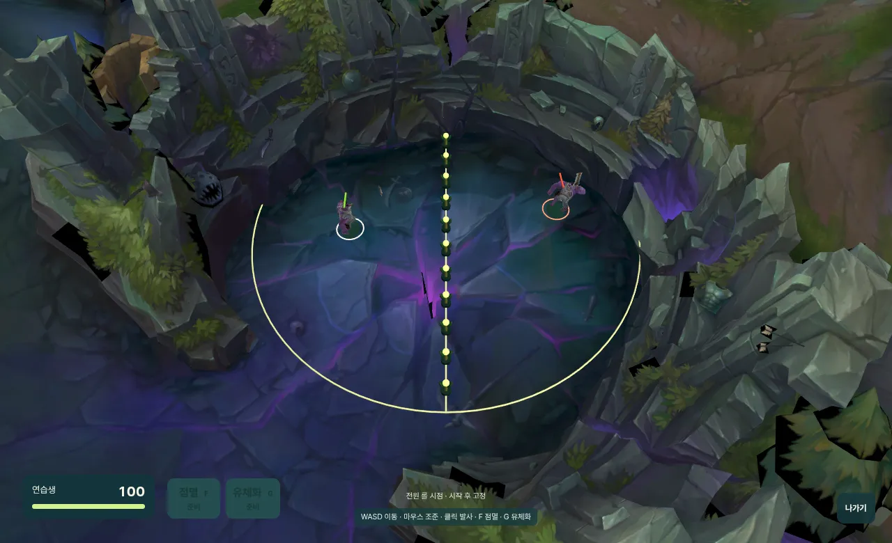
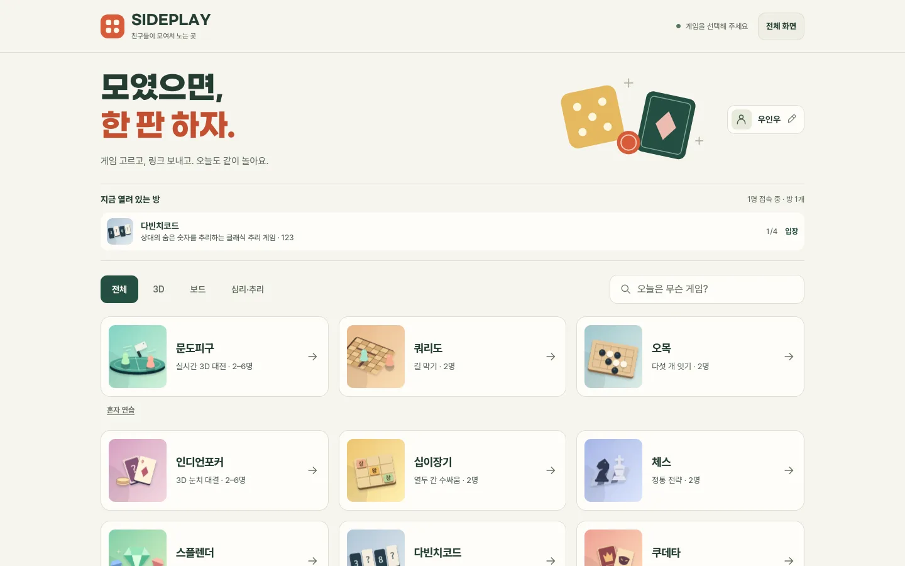
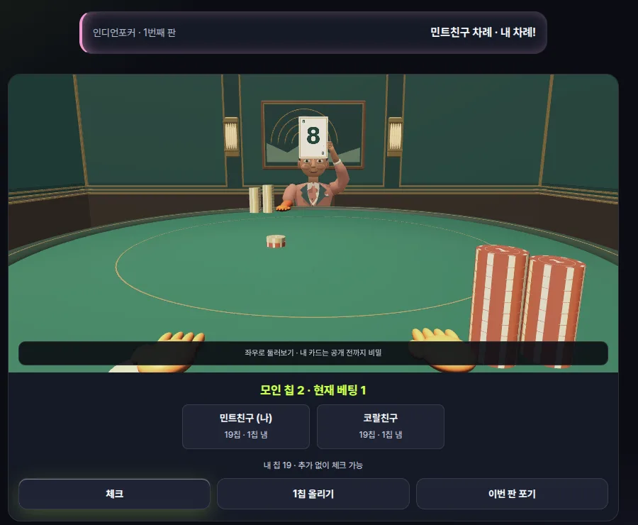

# SIDEPLAY

**친구와 초대 링크 하나로 같은 방에 모여 3D 피구와 보드게임을 즐기는 멀티플레이 웹게임입니다.**

실시간으로 움직이는 3D 피구와 차례대로 진행하는 보드게임을 같은 입장·준비·재접속 흐름으로 연결했습니다. PC와 모바일 참가자가 한 방에서 함께 플레이합니다.

[게임 목록](#게임-목록) · [설계와 문제 해결](#설계와-문제-해결) · [실행 방법](#실행) · [검증](#검증) · [에셋 출처](art/ASSETS.md)



> 문도피구 탑뷰. 두 참가자가 중앙 와드 줄을 사이에 두고 자기 반원 안에서 움직이며 식칼을 던집니다.

| 로비 | 인디언포커 |
|---|---|
|  |  |

## 설계와 문제 해결

| 어려웠던 점 | 처리 | 구현 근거 |
|---|---|---|
| PC와 모바일이 같은 경기에서 다른 결과를 본다. | 서버가 이동·발사 간격·충돌·체력·승패를 결정하고, 클라이언트는 입력과 렌더링만 맡는다. | [게임 서버](server/index.ts), [규칙](shared/game.ts) |
| 게임을 추가할 때마다 방·준비·재접속을 다시 만든다. | 턴제 게임의 상태 생성과 행동 처리는 순수 함수로 두고, 초대·준비·재접속·재경기는 공통 방 서버가 처리한다. | [공통 방 서버](server/tabletop.ts), [게임 목록](shared/catalog.ts) |
| 자기 카드·남은 덱·예약 카드가 네트워크로 새면 게임이 깨진다. | 비공개 정보는 참가자별 응답에서 서버가 숨긴다. | [포커](shared/poker.ts), [스플렌더](shared/splendor.ts) |
| 통신망이 바뀌면 경기에서 튕긴다. | 20초 동안 같은 세션으로 재접속하고, 이전 연결은 최대 10회 재시도로 정리한다. | [재접속 검사](tests/reconnect-browser.ts) |

> SIDEPLAY was created under Riot Games' "Legal Jibber Jabber" policy using assets owned by Riot Games. Riot Games does not endorse or sponsor this project.
>
> 문도피구의 문도 모델과 바론 둥지 맵은 Riot Games의 리그 오브 레전드 자산입니다. 비상업 팬 프로젝트로만 사용하며, 출처와 변환 과정은 [에셋 출처](art/ASSETS.md)에 기록합니다.

나머지 맵(원형 와드·장애물 경기장), 인디언포커의 인물·라운지, 보드게임 화면은 직접 만들었습니다. 저장소 이름 `cleaver-arena`와 기존 초대 링크·저장된 닉네임은 호환성을 위해 유지합니다.


## 게임 목록

| 게임 | 인원 | 적용 규칙 |
|---|---|---|
| 문도피구 | 2–6명 | 바론 둥지·원형 와드·기존 장애물 맵, 공통 시점·스펠 쿨타임 설정, 연습 로봇 |
| 쿼리도 | 2명 | 9×9, 벽 10개, 점프·경로 보존 |
| 오목 | 2명 | 15×15, 금수 없는 자유룰, 5개 이상 승리 |
| 인디언포커 | 2–6명 | 1인칭 3D 테이블, 1:1 개인 덱·기존 파티룰 선택 |
| 십이장기 | 2명 | 방 생성 시 동물장기·더 지니어스 기본룰 선택 |
| 체스 | 2명 | 캐슬링·앙파상·선택 승격, 체크메이트, 자동 반복·50수·기물 부족 무승부 |
| 스플렌더 | 2–4명 | 기본판 90장·귀족 10명, 황금·예약·반환·최종 라운드·공동 승리 |
| 다빈치코드 | 2–4명 | 흑백 0–11 타일 24장, 추측 실패 시 공개, 연속 추측 |
| 쿠데타 | 2–6명 | 5역할 ×3장, 챌린지·저지·쿠, 코인 10개 강제 쿠 |

오목·쿼리도·십이장기·체스는 칸을 선택하고 `선택한 수 확정`을 눌러 진행합니다. 쿼리도는 말 이동/가로 벽/세로 벽을 먼저 선택합니다. 벽을 놓을 때 선택한 칸의 아래 또는 오른쪽에 두 칸 길이로 놓입니다. 십이장기는 내 말 또는 보유 말을 먼저 고릅니다. 체스는 이동 가능한 칸을 표시하고 흑의 화면은 회전합니다.

인디언포커는 1인칭으로 테이블에 앉아 상대가 이마에 댄 카드를 보고 베팅합니다. 내 카드는 공개 전까지 서버 응답에서도 숨기며 남은 덱의 숫자·순서는 보내지 않습니다. 승인된 베팅은 손과 칩 던지기 동작으로 표현하며 좌우 드래그로 둘러볼 수 있습니다. 실제 돈을 사용하지 않습니다. 방 생성 시 고른 룰은 입장·재접속·재경기에도 유지됩니다.

| 포커 룰 | 카드와 칩 | 종료와 다음 판 |
|---|---|---|
| 1:1 승부룰 | 각자 독립적으로 섞은 1–10 개인 덱 10장. 매 판 자기 덱에서 한 장, 소진 후 다시 섞음. 20칩으로 시작하고 잔액 유지, 기본 1칩씩. 올릴 금액 선택 가능 | 동점은 팟 이월. 10 카드를 포기하면 남은 칩 한도에서 추가 10칩 이전. 파산하면 경기 종료. 공개 후 둘 다 다음 판 준비를 누르면 계속 |
| 기존 파티룰 | 2–6명, 공용 1–10 덱에서 중복 없이 한 장. 매 판 20칩으로 초기화. 기본 1칩씩, 1칩씩 올리기 | 가장 높은 카드 또는 마지막 남은 참가자가 한 판 승리. 동점 이월과 10 포기 벌칙 없음 |

1:1 승부룰은 요청한 개인 덱 방식의 변형 룰입니다. 선은 매 판 번갈아 맡고, 추가 베팅은 두 사람이 모두 맞출 수 있는 금액으로 제한해 사이드 팟을 만들지 않습니다. 전액 베팅한 동점으로 둘 다 잔액이 0이면 기본 칩 없이 다음 카드를 뽑고 체크로 승부합니다. 최종 종료 후 방의 준비 버튼으로 재경기하면 두 사람 모두 20칩으로 돌아갑니다.

포커의 인물·라운지는 프로젝트에서 직접 만든 GLB 에셋이며 외부 유료 에셋이나 생성 서비스 키가 필요하지 않습니다. 모델 두 개의 합계는 약 1.1MB입니다. Blender 제작 스크립트는 `art/poker/build_scene.py`, 게임용 파일은 `public/models/`에 있습니다. Blender의 Python 환경에서 스크립트를 실행하면 GLB와 `artifacts/blender/poker-original-assets.blend`를 다시 만듭니다. 모델 다운로드나 3D 초기화가 실패하면 2D 카드 표시로 플레이를 이어갑니다.

십이장기는 방장이 생성할 때 룰을 정합니다. 입장·재접속·재경기에도 방의 룰을 유지하며, 다른 룰로 바꾸려면 새 방을 만듭니다.

| 십이장기 룰 | 포로 투입 | 왕 이동과 승리 |
|---|---|---|
| 동물장기 | 상대 끝줄을 포함한 빈칸. 투입한 자는 즉시 승급하지 않음 | 자기 왕을 위험에 놓는 수 금지. 안전한 상대 끝줄 진입 또는 포획으로 즉시 승리 |
| 더 지니어스 기본룰 | 상대 끝줄에 모든 포로 투입 금지 | 왕이 공격받는 수 허용. 왕 포획 또는 상대 끝줄에서 상대 한 턴을 버티면 승리 |

두 룰 모두 말의 이동·포획·승급을 지원하고, 이 게임에서는 같은 국면 3회 반복을 무승부, 가능한 수가 없으면 패배로 처리합니다. 방송 결승전 전용 아이템과 90초 제한은 적용하지 않습니다.

## 스플렌더

기존 로비에서 스플렌더를 선택하고 2–4명이 준비하면 시작합니다. 방장이 먼저 시작합니다. 보석을 누르면 가져올 개수를 선택하고, 공개 카드나 내 예약 카드를 누르면 할인 후 구매 비용을 확인합니다. 지불할 색 보석을 줄이면 황금으로 대체하며, 보석이 있어도 황금을 대신 쓸 수 있습니다. 각 단계의 더미 예약은 상대에게 내용을 공개하지 않습니다.

황금 포함 보석이 10개를 넘으면 돌려줄 보석을 직접 골라야 다음 차례로 넘어갑니다. 귀족은 매 차례 최대 한 명이며 여러 조건을 만족하면 선택합니다. 15점 이상을 얻은 뒤 마지막 참가자까지 차례를 마치고 점수, 구매 카드가 적은 순서로 승자를 정합니다. 두 기준이 같으면 해당 참가자들이 공동 승리합니다. 진행 예외로 획득·구매·예약이 전부 불가능할 때만 패스를 허용하고, 전원이 연속 패스하면 무승부입니다.

[공식 기본판 룰북](https://cdn.svc.asmodee.net/production-spacecowboys/uploads/2025/10/SCSPL01EN_SPLENDOR_RULES_LIGHT.pdf)을 기준으로 구현했습니다. 카드의 수치 데이터는 [bouk/splendimax](https://github.com/bouk/splendimax/blob/master/Splendor%20Cards.csv)와 [seal256/splendor](https://github.com/seal256/splendor/blob/master/assets/cards.csv)를 90장 전부 대조했습니다. 귀족 10명의 조건도 확인했습니다. 카드와 보석 외형은 프로젝트의 SVG·CSS로 표시하며 외부 이미지나 추가 라이브러리가 필요하지 않습니다.

## 새 게임 추가

1. `shared/catalog.ts`에 게임 ID, 제목, 인원, 규칙 안내를 추가합니다.
2. `shared/tabletop-types.ts`의 ID와 새 규칙 모듈을 추가합니다. 상태 생성과 행동 처리는 순수 함수로 작성하고 오류 시 상태를 바꾸지 않습니다.
3. `server/tabletop.ts`의 `definitions`에 생성 함수를 등록합니다. 비공개 정보가 있으면 참가자별 `view`를 반드시 지정합니다.
4. `src/tabletop.ts`에 보드 렌더러를 추가하고 `index.html` 로비 버튼에 `data-game` ID를 연결합니다.
5. 규칙 테스트와 두 브라우저 동기화 테스트를 추가합니다. 초대·준비·재접속·재경기는 기존 방 서버를 재사용합니다.

문도피구는 실시간 입력/시뮬레이션이므로 `/ws`, 턴제 게임은 `/table-ws`를 사용합니다. 둘 다 같은 서버와 주소로 제공됩니다. 서로 다른 게임의 방 코드는 혼용할 수 없습니다.

## 실행

Node.js 22 이상이 필요합니다. 이 프로젝트 폴더에서 실행합니다.

```bash
npm ci
npm run build
npm start
```

접속 주소는 `http://localhost:3186`입니다. `PORT` 환경 변수로 포트를 바꿀 수 있습니다.

개발 중에는 `npm run server`와 `npm run dev`를 각각 실행합니다. Vite는 게임 서버의 3186 포트로 WebSocket 요청을 전달합니다.

## 친구와 플레이

1. 닉네임, 경기장, 게임 방식을 선택하고 방을 만듭니다. 기본은 바론 둥지 맵의 1:1이며, 원형 와드 맵과 기존 사각형 장애물 맵도 선택할 수 있습니다.
2. 초대 링크를 복사해서 친구에게 전달합니다. 친구는 닉네임을 입력하고 입장합니다.
3. 방장은 시작 전 설정에서 전원 공통 롤 시점/1인칭과 점멸·유체화 쿨타임을 정하고 적용합니다. 설정 변경 시 준비가 초기화됩니다. 모두 준비하면 3초 후 시작하며 시점과 쿨타임은 경기 중 고정됩니다. 바론 둥지와 원형 와드 맵은 1:1 또는 최대 3:3 팀전, 기존 맵은 2–6명 개인전 또는 팀전입니다. 팀전은 2명, 4명, 6명이 필요하고 팀은 자동으로 균등 배정합니다.
4. 체력은 100, 식칼 피해는 25입니다. 원형 맵에서는 중앙 와드 줄로 나눈 자기 반원 안에서만 이동하며 식칼은 중앙선을 통과합니다. 기존 맵은 전역을 이동하고 장애물로 식칼을 막습니다. 팀전에서 아군 피해는 없습니다.
5. 마지막 생존자 또는 생존 팀이 승리합니다. 제한 시간 2분에 여러 진영이 남으면 무승부입니다.
6. 경기 종료 후 모두 다시 준비하면 같은 맵에서 재경기를 시작합니다. 맵은 방 생성 시 고정되며 바꾸려면 새 방을 만듭니다.

혼자 확인하려면 첫 화면에서 `먼저 혼자 연습해 보기`를 누르면 됩니다.

## 조작

| 조작 | PC | 모바일 |
|---|---|---|
| 이동 | 롤 시점: 우클릭 목적지 이동 / 1인칭: WASD·방향키 | 왼쪽 조이스틱 |
| 탑뷰 조준 | 마우스 커서 | 오른쪽 패드를 원하는 방향으로 드래그 |
| 1인칭 조준 | 경기장 클릭 후 마우스 좌우 이동 | 오른쪽 패드를 좌우로 드래그 |
| 발사 | 마우스 왼쪽 버튼 / Q / Space | 오른쪽 패드에서 손 떼기 / 발사 버튼 |
| 점멸 | F | 점멸 버튼 |
| 유체화 | 롤 시점: D / 1인칭: G | 유체화 버튼 |
| 공통 시점 설정 | 방장의 시작 전 설정 | 방장의 시작 전 설정 |
| 마우스 고정 해제 | Esc | 해당 없음 |

점멸은 PC 롤 시점에서 마우스가 가리키는 방향, 1인칭·모바일에서는 조준 방향으로 최대 4만큼 이동합니다. 원형 맵의 중앙선과 외곽은 넘지 못하며, 기존 맵에서는 장애물을 넘을 수 있지만 안에 착지하지는 못합니다. 유체화는 6초 동안 이동 속도를 40% 높입니다. 기본 쿨타임은 점멸 20초, 유체화 30초입니다. 방장은 각각 1–300초, 6–300초 범위의 정수로 설정하며 재경기에도 유지합니다.

1인칭 이동은 카메라가 보는 방향 기준입니다. 이 게임은 수평 경기장이므로 위아래 조준이나 점프는 없습니다. 모바일은 가로 화면을 권장하며 세로 화면도 배치가 조정됩니다. 모바일에서 두 손가락을 동시에 사용할 수 있습니다.

## 간단한 배포

`render.yaml`에 Render Web Service 설정이 있습니다. 이 프로젝트를 Git 저장소로 올린 뒤 Render에서 Blueprint로 연결하거나 다음 설정으로 Web Service를 만듭니다.

- Build Command: `npm ci && npm run build`
- Start Command: `npm start`
- Health Check: `/health`
- Node.js: 22
- 인스턴스: 1개

발급된 HTTPS 주소 하나로 페이지와 WebSocket을 제공합니다. 정적 사이트 호스팅만으로는 실시간 게임 서버를 실행할 수 없습니다. 무료 인스턴스는 유휴 상태에서 잠들 수 있으므로 첫 접속이 느릴 수 있습니다.

임시로 친구에게 보여주려면 Cloudflare Quick Tunnel을 사용할 수 있습니다. `npm start`를 켜 둔 상태에서 설치된 cloudflared를 실행합니다.

```bash
cloudflared tunnel --url http://127.0.0.1:3186 --protocol http2
```

출력된 `https://…trycloudflare.com` 링크를 공유합니다. 이 주소는 임시이며, PC와 게임 서버, 터널 프로세스가 모두 실행 중이어야 합니다. 상시 운영은 Render 같은 서버 배포를 사용합니다.

## 검증

기본 확인(빠름):

```bash
npm run build
npm run test:quick   # 단위 + test:hub + test:fit + test:responsive
```

로비만 확인하려면 실행 중인 서버를 대상으로 `npm run test:hub`를 실행합니다. 첫 방문, 닉네임 변경·유지, 모바일 목록·페이지 전환, 검색·필터·빈 결과, 방 생성과 로비 복귀, 새 브랜딩을 검사합니다. 캡처도 필요하면 `SCREENSHOTS=1 npm run test:hub`를 사용하며 결과는 `artifacts/sideplay/`에 저장합니다. `CHROME_PATH`가 없으면 Playwright의 기본 브라우저를 사용합니다.

키보드 접근 흐름만 별도로 검사하려면 `KEYBOARD_ONLY=1 npm run test:hub`를 사용합니다. 이 경로는 포인터 조작이나 화면 캡처 검증을 대체하지 않습니다.

전체 브라우저 검증(느림, 필요할 때만):

```bash
npm run test:full
# 또는 개별: test:browser / test:tables / test:splendor / test:splendor:edges / test:reconnect
```

[스플렌더 규칙·실행 검증 기록](docs/splendor-audit.md)에 공식 규칙 대조, 방 예외, 실제 완주 및 희귀 상황 검사 범위를 정리했습니다.

브라우저 테스트는 실행 중인 게임 서버를 사용합니다. 기본 주소는 `http://127.0.0.1:3186`입니다. `BASE_URL`로 다른 주소를, `CHROME_PATH`로 Chromium 실행 파일을 지정할 수 있습니다. `CHROME_PATH`가 없으면 Playwright가 설치한 전체 Chromium을 사용합니다(`npx playwright install chromium`). 가벼운 headless shell은 WebGL 화면의 캡처가 수십 초씩 걸려 3D 검사가 시간 초과로 실패하므로, `CHROME_PATH`를 직접 지정할 때도 `chromium-*/chrome-linux64/chrome` 같은 전체 Chromium을 지정합니다. 캡처는 `artifacts/`에 저장되고 Git에서 제외됩니다.

검증 범위는 입력·시작 전 설정 권한 검증, 세 맵의 이동·장애물·반원 경계, 명중·승패·재경기, 방 분리·재접속, 두 브라우저 동기화, 두 카메라, 모바일 터치와 세로 화면입니다. 실제 iPhone/Android 기기의 성능과 통신 지연은 별도 확인이 필요합니다.

## 운영 범위

방과 게임 상태는 서버 메모리에 보관하므로 서버 재시작이나 배포 시 사라집니다. 하나의 Node.js 인스턴스에서 사용하며 분산 서버와 영구 전적은 포함하지 않습니다. 문도피구 1:1 방 정원은 2명이며 팀전·기존 맵 개인전·포커는 최대 6명입니다.

연결이 끊기면 이동과 발사를 멈춥니다. 20초 동안 같은 세션으로 재접속할 수 있지만 경기 중 연결이 끊긴 플레이어는 생존 승리 판정에서 제외되므로 1대1은 상대 승리로 끝날 수 있습니다. 경기 도중 새 참가자는 받지 않습니다.

통신망 변경으로 이전 연결이 서버에 남아 있으면 유효 세션을 지우지 않고 최대 10회 재시도합니다. 서버의 이전 연결 정리에는 최대 약 20초가 걸릴 수 있으며, 정리 후 20초간 복귀를 허용합니다. 명시적으로 나가면 즉시 행동 권한을 해제하고 다음 정리 주기에 퇴장 처리합니다. 나간 방의 세션은 복구하지 않습니다. 미준비자가 퇴장해 남은 전원이 준비 상태가 되면 인원 조건을 충족하는 방은 자동으로 시작합니다.

초대 링크와 방 코드를 아는 사람이 입장할 수 있습니다. 별도 계정이나 비밀번호 인증은 없습니다.

## 기술

TypeScript, Babylon.js, Node.js, ws, Vite, chess.js를 사용합니다. 서버가 이동·발사 간격·충돌·체력·승패를 결정하고 클라이언트는 두 카메라와 입력, 렌더링을 담당합니다. 소규모 게임에 맞춰 Colyseus 대신 WebSocket 방 관리를 직접 구현했습니다.

문도와 바론 둥지의 출처·제작 과정은 [에셋 출처](art/ASSETS.md)에 기록합니다. 바론 둥지는 과거 소환사의 협곡 원본에서 잘라낸 맵이며 최신 시즌 맵 전체를 구현한 것은 아닙니다.

폰트는 Pretendard이며 라이선스는 `public/FONT-LICENSE.txt`에 있습니다.

참고: [Babylon.js](https://www.babylonjs.com/specifications/), [Render WebSocket](https://render.com/docs/websocket), [Render 무료 인스턴스](https://render.com/docs/free), [Cloudflare Quick Tunnel](https://developers.cloudflare.com/cloudflare-one/networks/connectors/cloudflare-tunnel/do-more-with-tunnels/trycloudflare/).

규칙 참고: [Gigamic 쿼리도](https://export.gigamic.com/wp-content/uploads/2021/01/INS-RULES-QUORIDOR_10-2016.pdf), [LPSA 승인 동물장기 설명서](https://planeta-igr.com/image/data/instrukcii/93159.pdf), [tvN 십이장기](https://tvn.cjenm.com/ko/thegenius3/contents3/), [chess.js](https://jhlywa.github.io/chess.js/). 체스의 3회 반복·50수 무승부는 이 게임의 자동 판정 방식이며, [FIDE 대회 규정](https://handbook.fide.com/chapter/e012023)의 청구 절차와는 다릅니다.

## 라이선스

소스 코드는 [MIT 라이선스](LICENSE)를 따릅니다. 아래 파일은 MIT 라이선스에 포함되지 않습니다.

- `public/models/mundo.glb`, `public/models/mundo-cleaver.glb`, `public/models/baron-pit.glb`와 이 에셋이 보이는 화면 캡처: 리그 오브 레전드 자산에서 만든 파일로 권리는 Riot Games에 있습니다. 출처는 [에셋 출처](art/ASSETS.md)에 있습니다.
- `public/fonts/`의 폰트 파일: 각 폰트의 라이선스를 따릅니다. Pretendard는 `public/FONT-LICENSE.txt`의 SIL Open Font License 1.1입니다.
